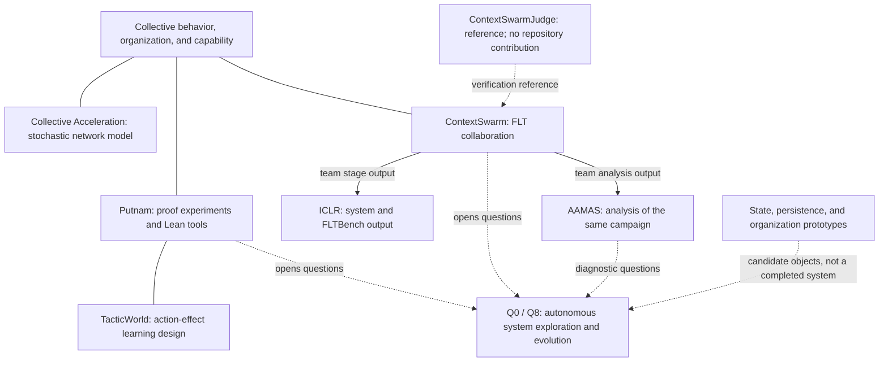

# Research graph

[中文](research-graph.zh-CN.md) · [Development](../research-development.md) · [Current questions](../current-questions.md)

This graph shows relationships among questions, projects, and outputs—not software dependencies, execution order, or a strict chronology. A relationship is not established causation, and inclusion does not make every repository my contribution.

Solid interest-to-project lines are thematic; ContextSwarm-to-submission arrows identify outputs. Dashed arrows mark references or research questions. TacticWorld is a parallel exploration with incomplete training. Q0/Q8 are open directions, not available capabilities.

## Questions and entry points

| Question | Representative work |
| --- | --- |
| [Q0: autonomous discovery and retention of useful changes](../current-questions.md#q0) | Putnam, ContextSwarm, AAMAS analysis, and state/organization prototypes. |
| [Q1: trustworthy local feedback](../current-questions.md#q1) | [Proof loop](../projects/pi-math-first-proof-swarm.md), [pi-lean-tools](../projects/pi-lean-tools.md), [TacticWorld](../projects/tacticworld.md). |
| [Q2: unfinished work](../current-questions.md#q2) / [Q3: actual inheritance](../current-questions.md#q3) | [Metron](../projects/metron.md), [Persistent Mathematical Worlds](../projects/persistent-mathematical-worlds.md), [MathWeave](../projects/mathweave.md). |
| [Q4: replacement contracts](../current-questions.md#q4) | [PMW Research Platform](../projects/pmw-research-platform.md), [Aperture](../projects/aperture.md), [Rights in the Exponent](../projects/rights-in-the-exponent.md). |
| [Q5: bounded learning from failure](../current-questions.md#q5) | [FLT/AAMAS analysis](../projects/flt-proof-weaving-aamas.md), [Trace analysis](../projects/trace-analysis.md), [Agent Math Frontier](../projects/agent-math-frontier.md). |
| [Q7: local work becoming collective progress](../current-questions.md#q7) | [Collective Acceleration](../projects/collective-acceleration.md), [ContextSwarm](../projects/contextswarm.md). |
| [Q8: resources and diversity for evolution](../current-questions.md#q8) | Future questions motivated by practice, without effectiveness results yet. |
| [Q6: preserving shared experience](../current-questions.md#q6) | [oncewhere](../projects/oncewhere.md), an adjacent creative work only. |

## What the machine indexes preserve

[project-index.json](../project-index.json) records sources, maturity, personal roles, evidence, limits, relations, and observations that changed questions. [question-index.json](../question-index.json) contains question summaries and links; [current questions](../current-questions.md) owns the prose.

Relation layers distinguish temporal, problem, constructive, evidence, collaborative-context, parallel, future, and adjacent links. A collaborative-context edge does not establish personal contribution; read `ownership` and the card. ContextSwarmJudge remains `reference` in every view, not a collaborative contribution.

The graph is a reading aid. Transitions and claims need not become separate database objects before their semantics justify it. New artifacts may open a new direction rather than fitting a single pre-existing route.
