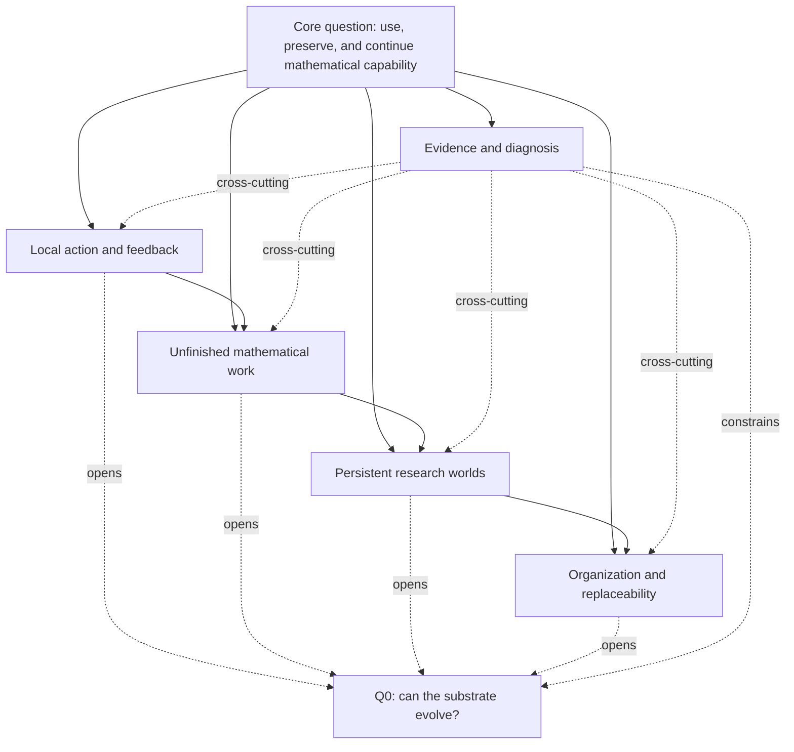
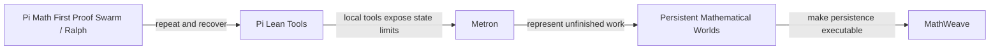

# Research graph

## The repository is a graph, not only a timeline

The timeline in [research development](../research-development.md) records when the question changed. It is necessary, but it cannot express the full structure of the work: which project exposed a limitation, which project tested a response, which artifact supports a claim, and which projects share a question without forming a sequence.

The underlying model is:

> **Researching Research is a temporal, typed, evidence-aware graph of questions, projects, transitions, artifacts, and claims.**

Time records when a node appeared. Typed edges record why it remains connected to another node.

This graph is not:

- a workflow that every project must follow;
- a maturity ladder;
- a dependency graph for one software system;
- a claim that every later idea was present at the beginning.

The historical sequence remains useful as one view of the graph. It is not the graph itself.

## The stable root question

The root is the question that remained recognizable while its objects changed:

> How can I build an environment that lets an AI agent use its mathematical capability, preserve useful work, and continue from it when the task, session, or agent changes?

The graph branches because different experiments made different parts of that question concrete.

The diagram shows problem clusters, not execution order. The solid links are problem lineage, not a temporal execution order. Evidence and diagnosis cut across every cluster. Q0 is a planned hypothesis with multiple parents; it is not a completed project.

## What the nodes mean

| Node type | Meaning | Examples |
| --- | --- | --- |
| Project | A repository, apparatus, collaboration, or adjacent work | Pi Math First Proof Swarm, Metron, MathWeave, ContextSwarm |
| Question | A problem that can remain open across projects | Q1 feedback, Q2 unfinished work, Q3 persistence, Q4 replaceability |
| Transition | An observation or limitation that changes the next question | local feedback is not enough; retrieval is not admission |
| Artifact | A commit, experiment, paper section, figure, trace, or decision record | fixed commit, experiment branch, manuscript analysis |
| Claim or insight | A bounded interpretation supported by one or more artifacts | shared state is not shared cognition |
| Hub or document | A place that organizes the graph | this atlas, research plan, current questions |

A project is therefore not only a node in a sequence. It can be a bridge between several questions, or an evidence source for a claim that also appears in another branch.

## The edge layers

The same pair of nodes may have more than one legitimate relationship. The edge should say which relationship is being asserted. Relation types are semantic labels, not a promise that every arrow is a single causal or temporal direction; the current temporal spine remains in research-development, while project relations describe problem, evidence, construction, and other cross-links.

| Layer | What it records | Example |
| --- | --- | --- |
| Temporal | Historical order or overlap | Pi Lean Tools precedes Metron |
| Problem lineage | How an observation changes a question | ContextSwarm opens a question about shared state |
| Constructive | What a project builds on or makes executable | MathWeave implements a boundary around persistent-world semantics |
| Evidence | What supports, limits, or fails to support a claim | a fixed commit supports an implementation claim |
| Collaborative | How work was jointly produced or observed | the author contributed to ContextSwarm analysis |
| Parallel | Shared concern without a strict sequence | Rights in the Exponent shares a concern with Aperture |
| Future | A planned test or unresolved hypothesis | several branches open Q0 |
| Adjacent | A thematic connection outside the technical system | oncewhere is thematically adjacent to the atlas |

The current `relations` and `changed_by` fields in [project-index.json](../project-index.json) are the first machine-readable layer of this graph. The question nodes and their short summaries are registered in [question-index.json](../question-index.json); the prose in [current-questions.md](../current-questions.md) remains the source of truth. This v2 machine layer is a project/question skeleton: transition, claim, and artifact nodes remain in the prose cards and research-development table until their semantics are stable enough to justify another artifact.

## The important subgraphs

### 1. Local capability and state

This branch follows the movement from making an agent act, to helping it inspect local state, to representing unfinished work, to preserving and admitting state. It is a problem lineage, not a claim that each project is a software dependency of the next.

### 2. Collaborative diagnosis and verification

ContextSwarm and ContextSwarmJudge form a collaborative branch. The first makes large-scale agent activity, workspace, CPS, and ProofState state visible. The second makes Lean execution, judging, queues, and terminal verification receipts explicit. Together they exposed the gap between local activity and reusable mathematical state.

That branch connects to Trace analysis, which studies what happened in the activity; Agent Math Frontier, which supplies evidence vocabulary; Metron, which asks how unfinished work should be represented; and persistent worlds, which ask what a later agent may safely inherit.

These are collaborative influences and evidence sources, not proof that the whole repositories were individually authored by me.

### 3. Organization and replacement

Persistent Mathematical Worlds, PMW Research Platform, Rights in the Exponent, and Aperture are related but not simply sequential:

- Persistent Mathematical Worlds studies the semantics of inherited external state;
- PMW Research Platform studies runtime and cohort boundaries;
- Rights in the Exponent studies how architectures assign force to information;
- Aperture studies levels of replaceability and mutable dependencies.

They share a question about what remains meaningful when state, runtime, permissions, or organization changes. Their relationship is partly constructive and partly parallel.

### 4. The future hypothesis

Q0 is not the final node of a completed ladder. It is a convergence point for several unresolved branches:

- local feedback and action;
- unfinished-state representation;
- persistent state and admission;
- organizational replacement;
- evidence and diagnosis.

The next experiment should vary one substrate choice at a time while fixing the model, toolchain, verifier, budget, provenance boundary, and holdout tasks. A future artifact earns a new project card only after it exists and changes the evidence graph.

## Three ways to read the atlas

The same repository supports three projections:

1. **History view** — read the time-ordered development document to understand how the question changed.
2. **Research graph view** — read this document and the project cards to understand why projects, questions, and limitations are connected.
3. **Evidence view** — follow fixed commits, experiments, decision records, and bounded claims to ask what supports what.

No single diagram should carry all three meanings. A clear timeline is still useful; it is simply one projection of a richer graph.
