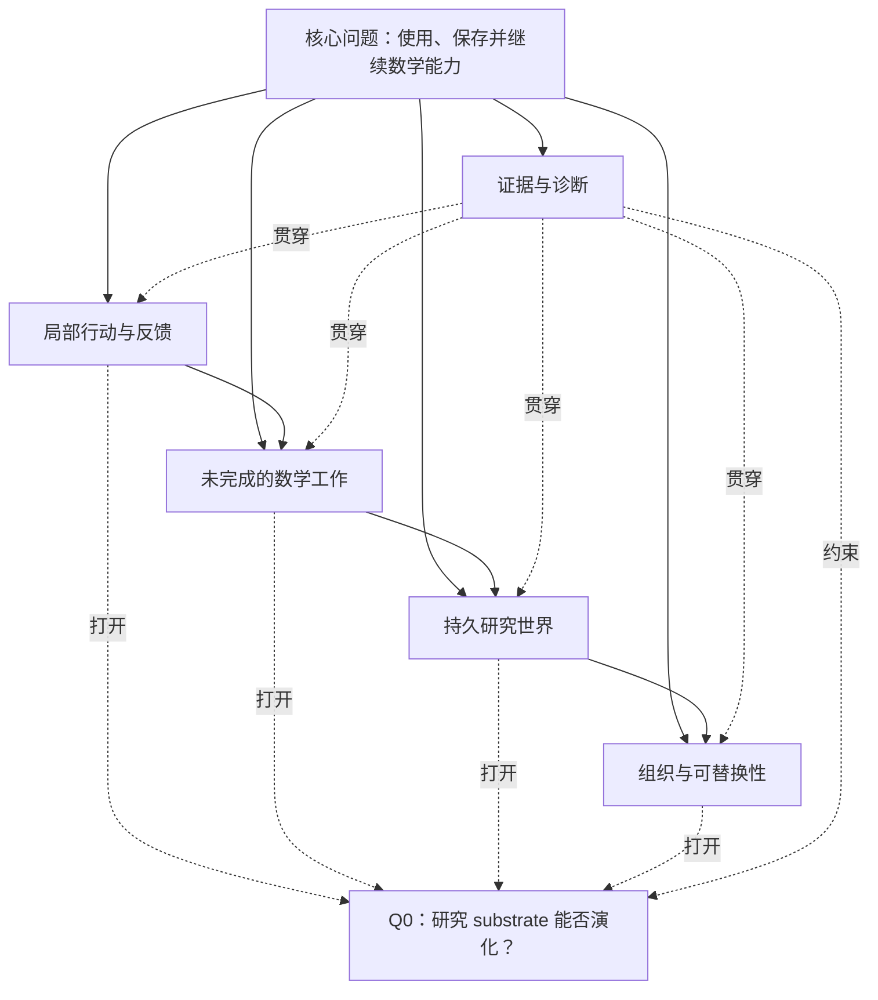
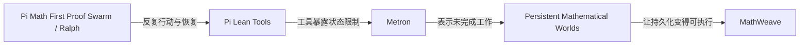
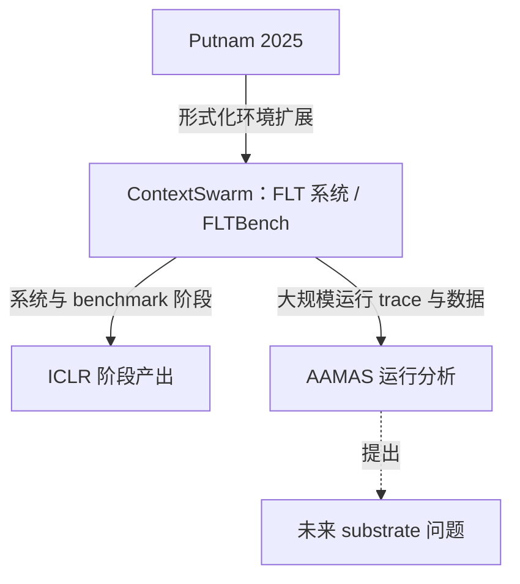

# 研究图谱

## 这个仓库不只是一条时间线

[研究发展历程](../research-development.zh-CN.md)记录了研究问题何时发生变化。这很重要，但它不能表达项目之间完整的内在结构：哪个项目暴露了什么限制，哪个项目回应了什么问题，哪个 artifact 支持了什么判断，以及哪些项目共享一个问题却不构成简单的前后顺序。

因此，这个仓库的底层模型应该是：

> **Researching Research 是一个由问题、项目、转折、artifact 和证据组成的、带时间标记的有类型研究图。**

时间记录一个节点何时出现；有类型的边记录它为什么与另一个节点保持联系。

这个图不是：

- 所有项目都必须遵循的 workflow；
- 一条从低级到高级的成熟度阶梯；
- 一个软件系统的依赖图；
- 声称所有后来的想法一开始就已经存在。

时间顺序仍然有用，但它只是这个图的一个视图。

## 稳定的根问题

根节点是这样一个问题：它的对象不断变化，但关切始终可以辨认：

> 如何构造一个环境，让 AI agent 能够使用数学能力、保存有价值的工作，并在任务、会话或 agent 被替换之后继续工作？

图之所以分支，是因为不同实验让这个问题的不同部分变得具体。

这张图表达的是问题簇，不是执行顺序。实线表达问题发展的关系，不代表时间上的执行顺序。证据与诊断贯穿所有分支；Q0 是由多个分支共同打开的计划中假说，不是已经完成的项目。

## 图中的节点是什么

| 节点类型 | 含义 | 例子 |
| --- | --- | --- |
| Project | repo、实验 apparatus、协作项目或相邻创作 | Pi Math First Proof Swarm、Metron、MathWeave、ContextSwarm |
| Question | 可以跨项目持续存在的问题 | Q1 反馈、Q2 未完成工作、Q3 持久化、Q4 可替换性 |
| Transition | 改变下一步问题的观察或限制 | 局部反馈不够；retrieval 不等于 admission |
| Artifact | commit、实验、论文段落、figure、trace 或 decision record | fixed commit、实验 branch、manuscript analysis |
| Claim / insight | 由一个或多个 artifact 支持的有限判断 | shared state 不等于 shared cognition |
| Hub / document | 组织研究图的中心文档 | 这个 atlas、研究计划、当前问题 |

因此，一个项目不只是时间序列中的一个节点。它可以同时连接多个问题，也可以成为一个跨分支 claim 的证据来源。

## 问题与代表性连接

问题索引为这张图提供了第二个适合人阅读的入口。下面的表格只列代表性连接，不是完整邻接表；每一行都指向当前问题正文和少量项目卡。

| 问题 | 它保持哪些问题彼此区分 | 代表性连接 |
| --- | --- | --- |
| [Q0](../current-questions.md#q0) | 把 substrate 演化作为受控研究假说 | [Putnam 2025](../projects/putnam-2025.md)、[ContextSwarm: FLT formalization system](../projects/contextswarm.md)、[ICLR stage output](../projects/flt-iclr-stage-output.md)、[AAMAS run analysis](../projects/flt-proof-weaving-aamas.md)、[Pi Lean Tools](../projects/pi-lean-tools.md)、[ContextSwarm](../projects/contextswarm.md)、[Metron](../projects/metron.md)、[Persistent Mathematical Worlds](../projects/persistent-mathematical-worlds.md)、[MathWeave](../projects/mathweave.md)、[Aperture](../projects/aperture.md) |
| [Q1](../current-questions.md#q1) | 可信的局部行动与可检查反馈 | [Pi Math First Proof Swarm](../projects/pi-math-first-proof-swarm.md)、[Pi Lean Tools](../projects/pi-lean-tools.md)、[Agent Math Frontier](../projects/agent-math-frontier.md) |
| [Q2](../current-questions.md#q2) | 未完成工作、provenance 与状态的表示 | [ContextSwarm](../projects/contextswarm.md)、[ContextSwarmJudge](../projects/contextswarm-judge.md)、[Metron](../projects/metron.md)、[MathWeave](../projects/mathweave.md) |
| [Q3](../current-questions.md#q3) | 超越增大 context window 的继承与 admission | [ContextSwarm](../projects/contextswarm.md)、[ContextSwarmJudge](../projects/contextswarm-judge.md)、[Metron](../projects/metron.md)、[Persistent Mathematical Worlds](../projects/persistent-mathematical-worlds.md)、[MathWeave](../projects/mathweave.md) |
| [Q4](../current-questions.md#q4) | 在明确 semantic contract 层级上的替换 | [PMW Research Platform](../projects/pmw-research-platform.md)、[Rights in the Exponent](../projects/rights-in-the-exponent.md)、[Aperture](../projects/aperture.md)、[Pi Lean Tools](../projects/pi-lean-tools.md) |
| [Q5](../current-questions.md#q5) | 从失败中学习，同时保留证据区分 | [Agent Math Frontier](../projects/agent-math-frontier.md)、[Trace analysis](../projects/trace-analysis.md)、[MathWeave](../projects/mathweave.md) |
| [Q6](../current-questions.md#q6) | 保存并重新回到一段共享经验 | [oncewhere](../projects/oncewhere.md) |

## 边的类型

同一对节点之间可能存在多种合理关系。边应该说明它表达的是哪一种关系。关系类型是语义标签，不保证每条箭头都代表单一的因果或时间方向；当前的时间主线仍然由研究发展历程表达，项目关系主要表达问题、证据、构造和其他横向连接。

| 层 | 记录什么 | 例子 |
| --- | --- | --- |
| Temporal | 历史先后或时间重叠 | Pi Lean Tools 先于 Metron |
| Problem lineage | 观察如何改变问题 | ContextSwarm 打开 shared state 问题 |
| Constructive | 项目建立在什么之上，或把什么变成可执行对象 | MathWeave 把持久世界边界变成可执行 ledger |
| Evidence | 什么支持、限制或不能支持某个 claim | fixed commit 支持实现存在的主张 |
| Collaborative | 工作如何被共同完成或共同观察 | 作者参与 ContextSwarm 分析 |
| Parallel | 共享关切，但不构成严格顺序 | Rights in the Exponent 与 Aperture 共享 replaceability 关切 |
| Future | 计划中的测试或未解决假说 | 多个分支共同指向 Q0 |
| Adjacent | 技术系统之外的主题关联 | oncewhere 与这个 atlas 主题相邻 |

这一版快照有意把时间层主要留在研究发展历程中；项目关系保持稀疏，只有在跨项目连接足够确定时才分配 layer。

当前 project-index.json 中的 relations 和 changed_by 是这张图的第一层机器可读表示，问题节点及其短摘要则登记在 [question-index.json](../question-index.json) 中；[current-questions.md](../current-questions.md) 仍然是问题正文的唯一来源。这一版机器层只是 project/question skeleton；转折、claim 和 artifact 节点仍保留在项目卡和研究发展表中，等语义稳定后再拆成独立记录。

## 重要的子图

### 1. 局部能力与研究状态

这条分支表达的是：从让 agent 行动，到让它检查局部状态，再到表示未完成工作，最后保存并承认研究状态。它是问题发展的关系，不表示每个项目都是下一个项目的软件依赖。

### 2. ContextSwarm 的 FLT 项目与两个产出分支

ContextSwarm 是 FLT 的核心协作项目。ICLR 和 AAMAS 是同一个项目的两个视角：ICLR 阶段记录系统与 benchmark，AAMAS 阶段分析大规模运行给后继 agent 留下了什么。图谱不声称 FLT 的整体形式化目标已经完成。

### 2. 协作诊断与验证

ContextSwarm 和 ContextSwarmJudge 形成一条协作分支。前者让大规模 agent activity、workspace、CPS 和 ProofState 状态变得可见；后者让 Lean 执行、judge、队列和终态 verification receipt 变得明确。两者共同暴露了局部活动与可复用数学状态之间的差距。

这条分支又连接到：

- Trace analysis：分析发生了什么；
- Agent Math Frontier：提供证据分类语言；
- Metron：追问未完成工作如何表示；
- persistent worlds：追问后继 agent 可以安全继承什么。

这些是协作影响和证据来源，不是把整个 repository 归为个人独立完成。

### 3. 组织与替换

Persistent Mathematical Worlds、PMW Research Platform、Rights in the Exponent 和 Aperture 相关，但不是简单的线性顺序：

- Persistent Mathematical Worlds 研究继承外部 state 的语义；
- PMW Research Platform 研究 runtime 和 cohort 的边界；
- Rights in the Exponent 研究 architecture 如何给信息分配力量；
- Aperture 研究 replaceability 的层级和可变依赖。

它们共同追问：当 state、runtime、权限或组织发生变化时，什么仍然保持有意义。它们之间既有构造关系，也有并行关系。

### 4. 未来假说

Q0 不是一条完成阶梯的最后节点，而是多个未解决分支汇聚到的计划问题：

- 局部反馈与行动；
- 未完成状态表示；
- 持久 state 与 admission；
- 组织替换；
- 证据与诊断。

下一轮实验应该一次只改变一个 substrate 选择，同时固定 model、toolchain、verifier、budget、provenance boundary 和 holdout tasks。只有当未来 artifact 实际存在并改变了证据图，才为它创建新的项目卡。

## 三种阅读方式

同一个仓库支持三种视图：

1. **History view**：按时间阅读研究发展历程，理解问题如何改变。
2. **Research graph view**：阅读这份文档和项目卡，理解项目、问题和限制为什么连接在一起。
3. **Evidence view**：沿着 fixed commit、实验、decision record 和有边界的 claim，追问什么支持什么。

不应该让一张图同时承载三种含义。清晰的时间线仍然有价值；它只是更丰富研究图谱的一个投影。
