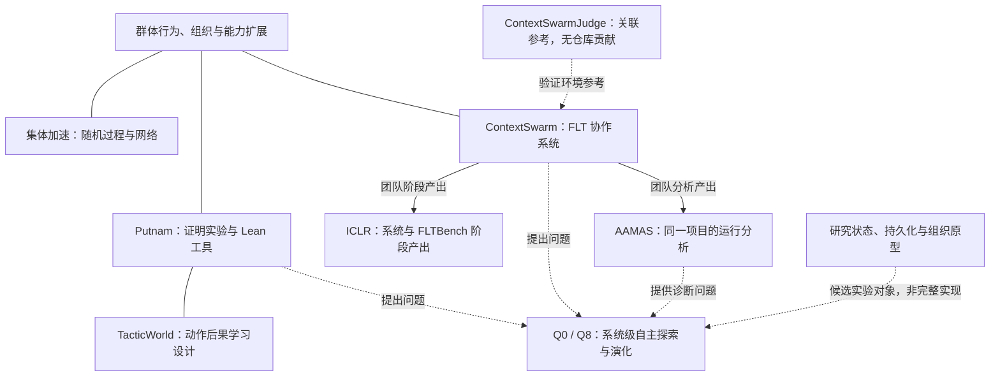

# 研究图谱

[English](research-graph.md) · [研究历程](../research-development.zh-CN.md) · [当前问题](../current-questions.md)

这张图表达问题、项目与产出的关系，不表达软件依赖、执行顺序或每个项目的严格先后。关系存在也不代表因果已经确立，更不代表图中的每个仓库都是我的成果。

图中的实线在工作与研究兴趣之间表示主题关系，在 ContextSwarm 与投稿之间表示产出关系；虚线表示参考或尚待研究的联系。TacticWorld 为并行探索，完整训练未完成；Q0/Q8 是开放方向，不是现成系统。

## 问题与入口

| 问题 | 代表性工作 |
| --- | --- |
| [Q0：系统能否自主发现并积累有效改动？](../current-questions.md#q0) | Putnam、ContextSwarm、AAMAS 分析，以及现有状态与组织原型。 |
| [Q1：局部反馈何时可信？](../current-questions.md#q1) | [证明闭环](../projects/pi-math-first-proof-swarm.md)、[pi-lean-tools](../projects/pi-lean-tools.md)、[TacticWorld](../projects/tacticworld.md)。 |
| [Q2：未完成工作怎样表示？](../current-questions.md#q2) / [Q3：共享状态何时成为实际继承？](../current-questions.md#q3) | [Metron](../projects/metron.md)、[Persistent Mathematical Worlds](../projects/persistent-mathematical-worlds.md)、[MathWeave](../projects/mathweave.md)。 |
| [Q4：替换需要什么条件？](../current-questions.md#q4) | [PMW Research Platform](../projects/pmw-research-platform.md)、[Aperture](../projects/aperture.md)、[Rights in the Exponent](../projects/rights-in-the-exponent.md)。 |
| [Q5：怎样从失败形成有边界的认识？](../current-questions.md#q5) | [FLT/AAMAS 分析](../projects/flt-proof-weaving-aamas.md)、[Trace analysis](../projects/trace-analysis.md)、[Agent Math Frontier](../projects/agent-math-frontier.md)。 |
| [Q7：局部工作怎样成为共同进展？](../current-questions.md#q7) | [集体加速](../projects/collective-acceleration.md)、[ContextSwarm](../projects/contextswarm.md)。 |
| [Q8：求解与演化怎样分配资源并保留多样性？](../current-questions.md#q8) | 来自系统实践的未来问题，尚无有效性结论。 |
| [Q6：共同经历怎样被保存与重新进入？](../current-questions.md#q6) | [oncewhere](../projects/oncewhere.md)，仅为相邻创作。 |

## 机器索引保留什么

[project-index.json](../project-index.json)保留项目、来源、成熟度、个人角色、证据、结果边界、关系与改变问题的观察。[question-index.json](../question-index.json)保留问题摘要与连接；[当前问题](../current-questions.md)是问题正文。

关系层区分时间、问题联系、构造、证据、合作情境、并行探索、未来方向与相邻创作。`collaborative` 关系层本身不证明作者贡献；个人角色必须读 `ownership` 与项目卡。`ContextSwarmJudge` 的 `reference` 身份在任何视图中都不应被当作合作贡献。

图谱是帮助阅读的视图，不必把每个转折都拆成独立数据库对象。新材料可以打开新方向，而不必强行落入现有的一条路线。
