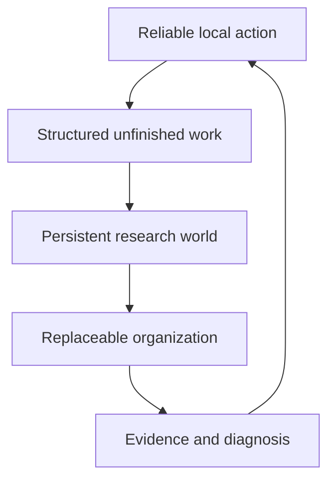

# Research arc

## A trajectory reconstructed from practice

This atlas should be read as a personal development, not as a workflow designed in full at the beginning. The sequence below records how the meaning of environment expanded as each experiment exposed a new limit:

Putnam 2025 → Pi Math First Proof Swarm / Ralph loop → Pi Lean Tools → ContextSwarm FLT formalization system and FLTBench → ICLR stage output and AAMAS run analysis → persistent and replaceable research worlds → future research substrate. ContextSwarm is the core collaborative FLT project; ContextSwarmJudge is its associated judging and verification branch.

The early experiments did not already contain the final question. The later abstraction grew from what the earlier environments could not preserve or explain.

## What did not change

I kept asking how to build a better environment so that an agent can use its mathematical capability, preserve useful work, and continue from it. What changed was the scale:

tools and local feedback → long action loops → shared swarm state → unfinished-work representation → persistent research worlds → replaceable and evolvable research systems.

## Current abstraction: five coupled questions

This is a current map of the problem space, not a maturity ladder and not the historical order in which every idea appeared.

## 1. Reliable local action

The first layer asks whether an agent can receive a useful signal close to the action it just took. Formal proof-state inspection, Lean-aware tools, cache behaviour, Ralph-style loops, and carefully designed experiments belong here.

My role has been especially concrete at this layer: prompt design, proof-state optimisation, experiment analysis, and issue fixing. A working feedback loop is evidence about an apparatus; it is not by itself evidence that the whole research process is effective.

## 2. Structured unfinished work

A long-horizon attempt is not just a scalar score. It may contain active routes, valid certificates, blocked obligations, discarded branches, and claims whose status is still provisional.

Metron is the clearest expression of this question in the current map. It makes the state of unfinished work inspectable while keeping the interpretation of that state open. The map therefore records it as a prototype for structured research state, not as a universal progress metric.

## 3. Persistent research worlds

A session should be replaceable without making the accumulated world disappear. Persistent Mathematical Worlds tests whether agents can inherit a versioned external state while keeping provisional material distinct from accepted mathematics. MathWeave develops a map-first version of the same problem: an append-only ledger is canonical, while maps, retrieval, frontiers, and dossiers are derived views.

The difficult part is epistemic, not merely technical. A larger state is not automatically a better state; retrieval is not admission; and a relationship in a map does not automatically create a proof obligation.

## 4. Organization and replaceability

Once research state persists, the next question is organizational: who may write, verify, expose, replace, or migrate a piece of work?

PMW Research Platform explores the runtime boundary between a persistent world and replaceable research sessions. Rights in the Exponent studies how an architecture assigns force to information under explicit evidence labels. Aperture isolates levels of replaceability and tests where mutable dependencies break apparently reusable computation.

These projects narrow the claim. "Replaceable agent" is not one binary property; it has contracts, levels, and failure modes.

## 5. Evidence and diagnosis

The final layer asks how we know what happened. A portfolio can contain formal successes, executable specifications, precise informal statements, and research programs. A trace can show a failure without explaining its cause. An overall score can hide the route by which it was obtained.

The centre of gravity is therefore an evidence ledger: claims should point to the smallest inspectable artifact that supports them, and every card should state its non-claims. The result is a research atlas that can be revised without laundering uncertainty into a smooth success story.

## The current research hypothesis

The next direction is to let the substrate itself become a controlled research object: the objects, links, admission rules, handoff protocols, and challenge selection may change on training tasks, while the verifier, provenance boundary, replay rules, and held-out evaluation remain fixed. This is a hypothesis to test, not a conclusion already supported by the map.

See [the research-development history](research-development.md) and [the future research direction](docs/research-plan.md) for the distinction between the historical trajectory and a plan that has not yet been implemented.

## The place of oncewhere

oncewhere sits beside this arc as a creative work. Its first work, “月背拾遗司 · 第一夜”, turns real experience and relationships into something playable and preservable. It is not a technical component of the mathematical-agent system. It belongs in the atlas because it exposes the same personal intuition from another direction: what deserves to survive an immediate moment, and what form lets someone return to it?

## What would count as progress

Progress here is not more repositories. It is a stronger correspondence between:

- a research question;
- an explicit artifact;
- a fixed piece of evidence;
- a statement of personal contribution;
- a boundary on the claim;
- and a next question that could change the map.